<picture>
  <source media="(prefers-color-scheme: dark)" srcset="assets/branding/header-dark.svg">
  
</picture>

# Sumeet Musfirah

**Studying intelligence across biological and artificial systems.**

I study how agents, both people and language models, decide whom to believe, and how to
measure that reliably. My training is in research and experimental psychology at Drexel
University, with minors in data science and neuroscience. I build the evaluation infrastructure
myself.

`AI safety` · `model behavior` · `LLM evaluations` · `social influence` · `belief updating` ·
`NeuroAI` · `cognitive science` · `multimodal AI`

<picture>
  <source media="(prefers-color-scheme: dark)" srcset="assets/diagrams/research-map-dark.svg">
  
</picture>

## Currently investigating

- **Epistemic independence in interacting language models.** Does a model keep its own answer
  when another agent disagrees, and should it?
- **Confidence contagion and information cascades.** Can expressed certainty spread from model to
  model separately from the evidence behind it?
- **Persuasion and behavioral drift.** How emotional, social, and authority pressure shift what
  models say and do.
- **Evaluating AI systems in high-stakes settings.** Measurement that holds up when errors carry
  real cost, as in clinical work.
- **Human cognition ↔ artificial-agent behavior.** Using paradigms from social and cognitive
  psychology as instruments for studying models.

## Selected research

### Project Aletheia — artificial social influence

> **Question.** When language models receive information from other agents, do they update on
> *what* is said, or on *who* said it?

**Approach.** Aletheia is an independent research program on epistemic behavior in LLMs. It has
two studies so far.

- **Exp 001: source attribution and epistemic updating** *(preregistered; data collection not
  yet started).* A minimal-pair design holds the argument text byte-for-byte constant and varies
  only its attributed source (control, anonymous, expert, other model, consensus), crossed with
  whether the argument is correct or misleading. Five open-weight model families are tested.
  Outcomes (answer switching, appropriate vs. inappropriate updating) are scored
  deterministically against ground truth, with no LLM judge in the primary causal path.
- **Pressure evals v0.1** *(complete).* 180 outputs (3 open-weight models × 4 system-prompt
  conditions × 15 scenarios) were blind-scored on a six-dimension manipulation rubric. The
  conclusion depended on the judge. Under `qwen3:4b` the result was null (all primary tests
  p ≥ 0.63). Under `claude-sonnet-4-6`, an autonomy-preserving instruction reduced
  manipulation-coded language (p = 0.0003 vs. pressure). Inter-judge agreement was near chance,
  and the disagreement concentrated in the primary judge's own outputs. The study is reported as
  *evaluator-sensitive*, and both results are kept.

**Links.**
[`aletheia-pressure-evals`](https://github.com/Project-Aletheia-org/aletheia-pressure-evals) ·
[judge-sensitivity summary](https://github.com/Project-Aletheia-org/aletheia-pressure-evals/blob/main/reports/judge_sensitivity_summary.md) ·
Exp 001 repository is private until data collection ·
Talk: *"Can an AI Be Gaslit About Its Own Previous Answer?"*, Grace Hopper Celebration 2026 (accepted)
<!-- TODO: GHC 2026 session URL -->

Study design figures

 
<picture>
  <source media="(prefers-color-scheme: dark)" srcset="assets/research/aletheia-exp001-design-dark.svg">
  
</picture>
<picture>
  <source media="(prefers-color-scheme: dark)" srcset="assets/research/pressure-evals-judges-dark.svg">
  
</picture>

### Persuasion Topography of LLMs

> **Question.** Which kinds of social and emotional pressure move a model off its answer, and
> which leave it steady?

**Approach.** A behavioral evaluation framework built on a taxonomy of pressure types (emotional,
authority, guilt, urgency, social approval, epistemic). Each is applied to fixed prompts, and the
framework tracks agreement and refusal rates, hedging, confidence shifts, and recommendation
drift. Version 0 is an early exploratory stage: a synthetic prompt set, a local inference
pipeline, and qualitative analysis of pressure-response shifts.

**Links.** Repository private (early stage) <!-- TODO: link when public -->

### CogNeW Lab — EEG and neuromodulation

> **Question.** What do EEG and behavioral signals reveal about cognitive control, and about how
> individuals respond to neuromodulation?

**Approach.** Machine-learning research assistant in the CogNeW Lab at Drexel
(PI: John Medaglia). I built reproducible Python pipelines for EEG and behavioral data from
100+ participants, covering synchronization, artifact rejection, and time-series feature
extraction. I also trained and cross-validated Random Forest and SVM classifiers relating those
features to neuromodulation outcomes and markers of cognitive control.

**Links.** Lab work; no public code <!-- TODO: poster / abstract link if available -->

### ABIM — applied AI and evaluation in medicine

> **Question.** How do you build and evaluate AI systems where a wrong answer has clinical
> consequences?

**Approach.** AI Developer co-op, Emerging Technologies, American Board of Internal Medicine (2026).
- Built and productionized an evidence retrieval and synthesis platform over physician
  discussions and PubMed. It combines pgvector semantic search with reciprocal rank fusion to
  return cited answers, and runs on AWS with containerized CI/CD.
- Designed an LLM evaluation workflow for AI-generated clinical cases that analyzes model reasoning
  to flag rule violations and recurring error patterns.
- Built a multimodal physician-assessment model: pose estimation (RTMPose) and audio features
  feed a LoRA fine-tuned Qwen2.5-1.5B multi-label classifier.

**Links.** Internal work; no public code.

## Open questions

1. When should an artificial agent update its beliefs after observing another agent, and what
   would rational deference look like for a model?
2. Can confidence spread between models independently of evidence?
3. Can social-cognition paradigms such as source credibility, conformity, and gaslighting expose
   model failures that conventional benchmarks miss?
4. How should we measure epistemic autonomy in multi-agent AI systems?
5. When an LLM judge and a human disagree, or two LLM judges disagree, what counts as ground
   truth for model behavior?

## How I work

- **Preregister, then freeze.** Hypotheses, configs, and analysis plans are fixed before data;
  deviations are logged, not edited in.
- **Deterministic where possible.** Score against ground truth before reaching for an LLM judge,
  and when a judge is unavoidable, check the result against a second one.
- **Report what the evidence supports.** Nulls, evaluator dependence, and limitations are findings.

## Research outputs

| Output | Link |
| --- | --- |
| Google Scholar | forthcoming <!-- TODO: Google Scholar profile URL --> |
| arXiv | forthcoming <!-- TODO: arXiv author page / first preprint --> |
| ORCID | forthcoming <!-- TODO: ORCID iD URL --> |
| Publications | Co-author, peer-reviewed article on bacteria-inspired self-healing concrete, *Cement and Concrete Composites* <!-- TODO: DOI --> |
| Presentations & posters | *Can an AI Be Gaslit About Its Own Previous Answer?*, Grace Hopper Celebration 2026 (accepted) <!-- TODO: URL --> *Neurorights & Cognitive Sovereignty in Brain–AI Systems*, Mahoney Institute for Neurosciences Research Symposium, University of Pennsylvania <!-- TODO: poster PDF --> |
| CV | forthcoming <!-- TODO: link to CV PDF --> |
| Personal website | forthcoming <!-- TODO: site URL --> |
| LinkedIn | [linkedin.com/in/sumeetmusfirah](https://www.linkedin.com/in/sumeetmusfirah) |
| Research org | [github.com/Project-Aletheia-org](https://github.com/Project-Aletheia-org) |

## Engineering

The technical substrate behind the research:

| Layer | Tools |
| --- | --- |
| Modeling | Python · PyTorch · Hugging Face · scikit-learn · LoRA fine-tuning |
| LLM systems | vLLM · Ollama · OpenAI and Anthropic APIs · structured outputs · LLM-as-judge |
| Evaluation infrastructure | preregistered configs · SHA-256-hashed artifacts · deterministic scoring · permutation tests · judge-agreement diagnostics |
| Retrieval & data | PostgreSQL / pgvector · semantic search · reciprocal rank fusion · FastAPI |
| Multimodal & signals | computer vision (RTMPose, YOLO) · audio features · EEG / time-series pipelines |
| Infrastructure | Docker · AWS (EC2, RDS, S3, ECR) · CI/CD · Linux · NVIDIA DGX Spark |

 

  <picture>
    <source media="(prefers-color-scheme: dark)" srcset="assets/branding/footer-dark.svg">
    
  </picture>

