<picture>
  <source media="(prefers-color-scheme: dark)" srcset="assets/branding/header-dark.svg">
  
</picture>

<picture>
  <source media="(prefers-color-scheme: dark)" srcset="assets/branding/ticker-dark.svg">
  
</picture>

I study how language models, and the people who use them, decide whom to believe. My background
is in psychology and neuroscience at Drexel; I build the evaluation infrastructure myself.

### Signal

- **Grace Hopper Celebration 2026** (accepted talk): *Can an AI Be Gaslit About Its Own Previous Answer?*
- **[Pressure evals v0.1](https://github.com/Project-Aletheia-org/aletheia-pressure-evals)**: the same 180 model outputs, scored by two LLM judges, gave opposite conclusions about manipulation. The verdict depended on who graded it.
- **Project Aletheia**: a preregistered study of whether models update on *who* said something rather than *what* was said.
- **Applied AI at ABIM**: shipped a cited-evidence retrieval platform (pgvector + RRF on AWS), a multimodal assessment model, and an LLM evaluation workflow for clinical cases.
- **CogNeW Lab**: ML pipelines for EEG and neuromodulation data from 100+ participants.

### Stack

`Python` · `PyTorch` · `Hugging Face` · `vLLM` · `OpenAI / Anthropic APIs` · `FastAPI` · `PostgreSQL + pgvector` · `Docker` · `AWS` · `scikit-learn` · `multimodal CV` · `evaluation infrastructure`

  <a href="mailto:sumeetmusfirah23@gmail.com">Email</a> ·
  <a href="https://www.linkedin.com/in/sumeetmusfirah">LinkedIn</a> ·
  <a href="https://sumeetmusfirah.com">Website</a> ·
  <a href="https://github.com/Project-Aletheia-org">Project Aletheia</a>
  <!-- TODO: add ORCID and Google Scholar links here once found -->

  <picture>
    <source media="(prefers-color-scheme: dark)" srcset="assets/branding/footer-dark.svg">
    
  </picture>

